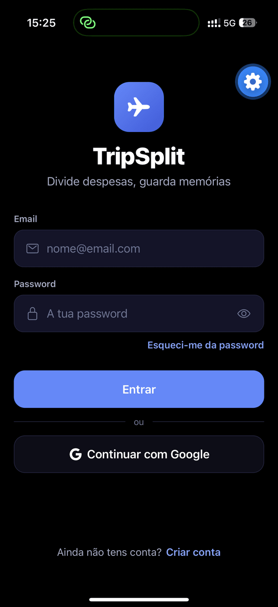
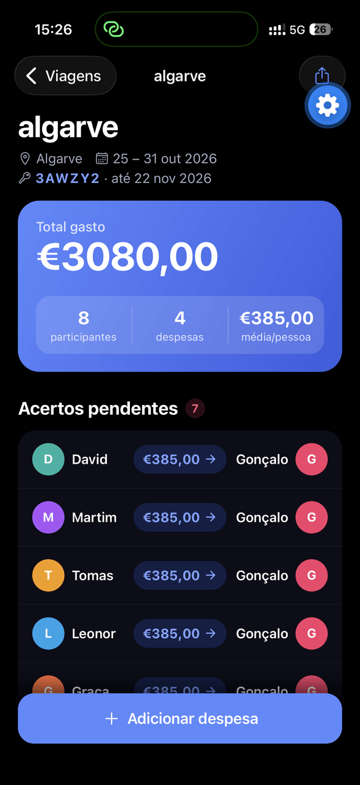
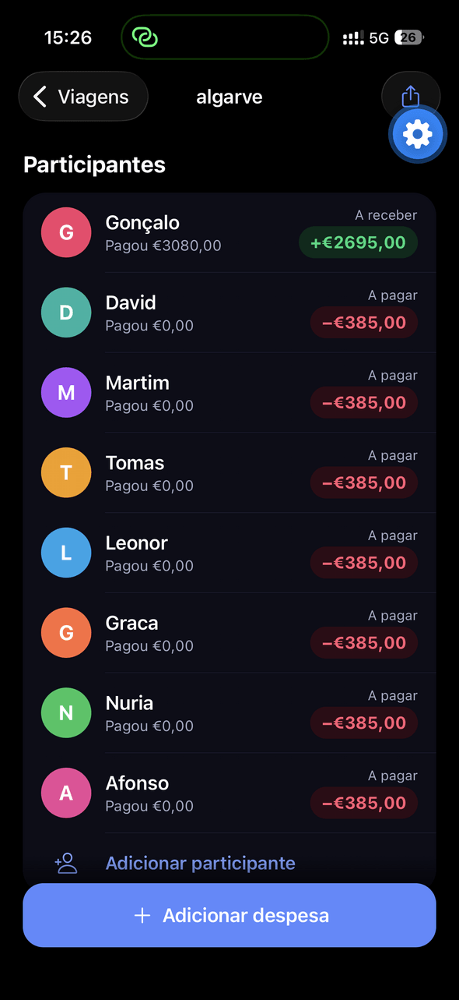
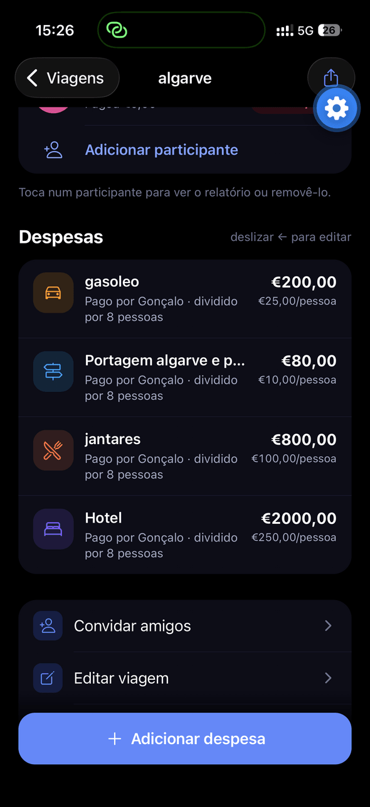
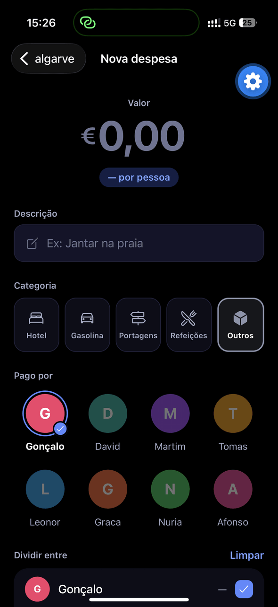
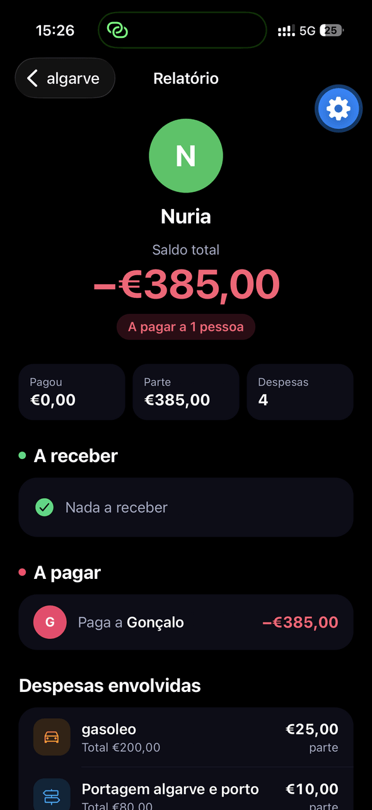

# TripSplit ✈️

Aplicação móvel para **dividir despesas de viagens em grupo**. Regista quem pagou o quê, divide cada despesa só por quem participou, e a app calcula automaticamente **quem deve pagar a quem** no fim da viagem.

Desenvolvida em **React Native (Expo)** com **Firebase** como backend, para iOS e Android.

| Entrar | Detalhes da viagem | Saldos por pessoa |
|:---:|:---:|:---:|
|  |  |  |
| **Despesas** | **Nova despesa** | **Relatório individual** |
|  |  |  |

<sub>Capturas no iPhone, modo escuro AMOLED (o botão da roda dentada é a ferramenta de desenvolvimento do Expo Go).</sub>

📸 **[Ver todos os ecrãs, com descrição →](docs/CAPTURAS.md)**

## Funcionalidades

- **Contas de utilizador** com email e password (Firebase Authentication), sessão persistente, recuperação de password e opção de apagar a conta e os dados
- **Viagens** com destino, datas (calendário de intervalo) e participantes
- **Despesas** com valor, categoria, quem pagou, entre quem se divide e **foto do recibo** (câmara ou galeria)
- **Acertos automáticos**: saldo de cada pessoa e lista curta de transferências para ficar tudo pago; cada transferência pode ser **marcada como paga** (e anulada), atualizando os saldos de todos
- **Editar viagens**: nome, destino e datas a qualquer momento
- **Resumo e relatórios**: gasto por categoria e relatório individual de cada participante
- **Viagens partilhadas em tempo real**: os amigos entram na viagem com um código curto (ex: `K7XB9Q`) e todos veem e editam as mesmas despesas, sincronizadas ao segundo
- **Amigos**: código de amigo pessoal, pedidos de amizade (aceitar/recusar) e convite direto de amigos para uma viagem
- **Modo escuro AMOLED** e interface pensada para iPhone e Android
- **Funciona com rede fraca**: as alterações aparecem logo e são sincronizadas quando houver ligação

## Tecnologias

| Área | Tecnologia |
|---|---|
| App | React Native 0.86, Expo SDK 57, React 19 |
| Navegação | React Navigation 7 (native stack) |
| Estado | Zustand |
| Backend | Firebase Authentication + Cloud Firestore |
| Imagens | Cloudinary (upload), expo-image-picker, expo-image-manipulator |
| UI | Ionicons, expo-linear-gradient, react-native-gesture-handler |

## Decisões técnicas

- **Cálculo dos acertos** (`utils/acertos.js`): para cada pessoa calcula-se *pago − parte*; depois os devedores são emparelhados com os credores até os saldos ficarem a zero, arredondando ao cêntimo para evitar erros de vírgula flutuante.
- **Escritas otimistas** (`store/storeViagens.js`): o estado local é atualizado de imediato e a gravação no Firestore segue em segundo plano. Sem rede, a app não bloqueia e não cria despesas duplicadas.
- **Viagens colaborativas** (`store/storeViagens.js`): cada viagem é um documento `trips/{id}` com `ownerId` e `members`; a app subscreve em tempo real (`onSnapshot`) as viagens de que o utilizador é membro. Despesas e participantes são alterados elemento a elemento (`arrayUnion`/`arrayRemove` em lote), para que edições simultâneas de pessoas diferentes não se sobreponham. As viagens do formato antigo são migradas automaticamente.
- **Convites por código** (`utils/codigoViagem.js`): códigos de 6 caracteres sem símbolos ambíguos (0/O, 1/I/L), com verificação de colisões e validade de 30 dias. `sharedTrips/{código}` aponta para a viagem; quem o usa é acrescentado aos membros.
- **Segurança** (`firestore.rules`): só membros leem e editam uma viagem; quem não é membro só se pode **acrescentar a si próprio** apresentando o código atual e dentro da validade; ninguém muda o dono nem remove outros membros; só o dono apaga. Os códigos não podem ser listados. As regras foram validadas com 58 testes no emulador do Firestore (`@firebase/rules-unit-testing`).
- **Validação de dados importados** (`utils/share.js`): tudo o que chega de fora é validado antes de entrar na app.
- **Valores em euros** (`utils/valor.js`): aceita `12,50`, `12.50` e `1.000,50`, rejeitando formatos ambíguos.
- **Design system próprio** (`utils/theme.js`, `components/ui/`): tokens de cor para claro/escuro, tipografia e componentes reutilizáveis, com atenção à acessibilidade (VoiceOver, "Reduzir movimento", alvos de toque ≥ 44px).

## Estrutura

```
App.jsx                 navegação e arranque
screens/                ecrãs (Login, Início, Detalhes, Nova despesa, Acertos, Resumo…)
components/ui/          componentes base (Botão, Cartão, Campo, Avatar, Folha inferior…)
store/                  estado global (Zustand): autenticação, viagens, tema
utils/                  lógica: acertos, valores, datas, partilha, Firebase
firestore.rules         regras de segurança do Firestore
__tests__/              testes unitários (Jest)
tests/regras/           testes das regras de segurança (emulador do Firestore)
```

## Correr o projeto

Requisitos: Node.js 20+ e a app **Expo Go** no telemóvel.

```bash
git clone https://github.com/Goncas06/Tripsplit.git
cd Tripsplit
npm install
cp .env.example .env      # e preenche com os dados do Cloudinary
npm start                 # lê o QR code com o Expo Go
```

O projeto usa um projeto Firebase próprio (`utils/firebase.js`). Para usares o teu, cria uma app Web no Firebase Console, substitui a configuração e publica as regras de `firestore.rules`.

> O login com Google precisa de uma build nativa (`npx expo run:ios` / `run:android`); no Expo Go está disponível o login com email e password.

## Testes

```bash
npm test                         # testes unitários (Jest): acertos, valores, datas, códigos, importação
```

As **regras de segurança do Firestore** têm 58 testes próprios, corridos no emulador local do Firebase (precisa de Java 11+):

```bash
cd tests/regras
npm install
npm test
```

Cobrem: só membros leem/editam viagens, adesão por código válido e não expirado, convites só entre amigos com amizade aceite, pedidos de amizade, e que ninguém muda o dono, expulsa outros membros ou lista códigos.

## Autores

Projeto desenvolvido por:

- **Gonçalo Duarte da Costa Oliveira Dias**
- **David Gomes Moreira**

O desenvolvimento contou com o **Claude Code** (assistente de programação com IA da Anthropic) como apoio na implementação, revisão e testes. As decisões de produto, a direção do projeto e a validação final foram dos autores.

## Licença

© 2026 Gonçalo Duarte da Costa Oliveira Dias e David Gomes Moreira. **Todos os direitos reservados.**

O código está público apenas para consulta. Não é permitido usar, copiar, modificar ou distribuir este projeto sem autorização escrita dos autores — ver [LICENSE](LICENSE).
