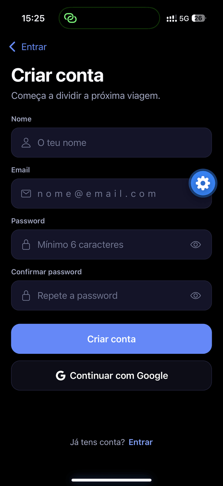
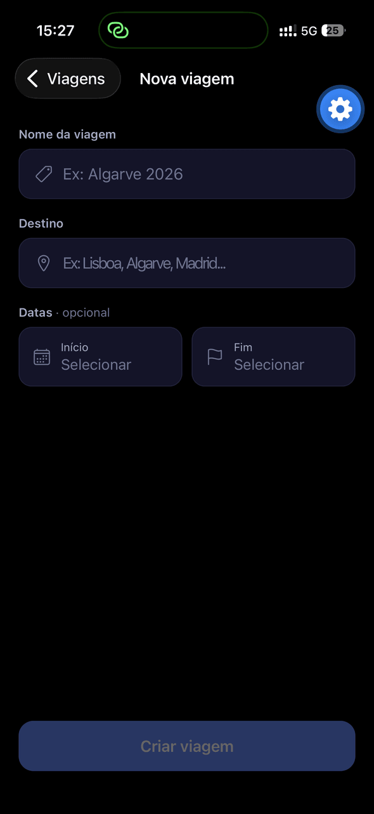
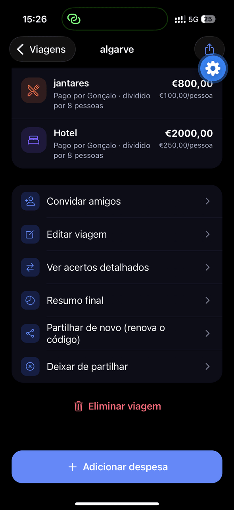

# TripSplit — capturas de ecrã

Percurso completo pela aplicação, num iPhone, em modo escuro AMOLED.
Os dados são de uma viagem de exemplo ("Algarve", 8 participantes, 4 despesas).

> O botão azul com a roda dentada que aparece no canto é a ferramenta de desenvolvimento do **Expo Go** — não faz parte da aplicação.

[← Voltar ao README](../README.md)

---

## 1. Entrada na aplicação

| Entrar | Criar conta |
|:---:|:---:|
|  |  |
| Email e password (Firebase Authentication), recuperação de password e entrada com Google. | Registo com validação dos campos e confirmação da password. |

## 2. Criar uma viagem

| Nova viagem |
|:---:|
|  |
| Nome, destino e datas (com calendário de intervalo). O mesmo ecrã serve para editar a viagem. |

## 3. A viagem

| Resumo e acertos | Participantes | Despesas |
|:---:|:---:|:---:|
|  |  |  |
| Total gasto, média por pessoa e a lista de **quem paga a quem**. O código `3AWZY2` permite a outra pessoa entrar na viagem. | Saldo de cada participante: verde a receber, vermelho a pagar. | Cada despesa com categoria, quem pagou e valor por pessoa. Deslizar para a esquerda para editar ou apagar. |

| Ações da viagem |
|:---:|
|  |
| Convidar amigos, editar a viagem, acertos detalhados, resumo final, partilha por código e eliminar. |

## 4. Registar uma despesa

| Nova despesa |
|:---:|
|  |
| Valor, descrição, categoria, quem pagou e entre quem se divide — o valor por pessoa é calculado enquanto se escreve. |

## 5. Relatório individual

| Relatório de uma pessoa |
|:---:|
|  |
| Saldo total, quanto pagou, a sua parte, a quem tem de pagar e em que despesas participou. |
